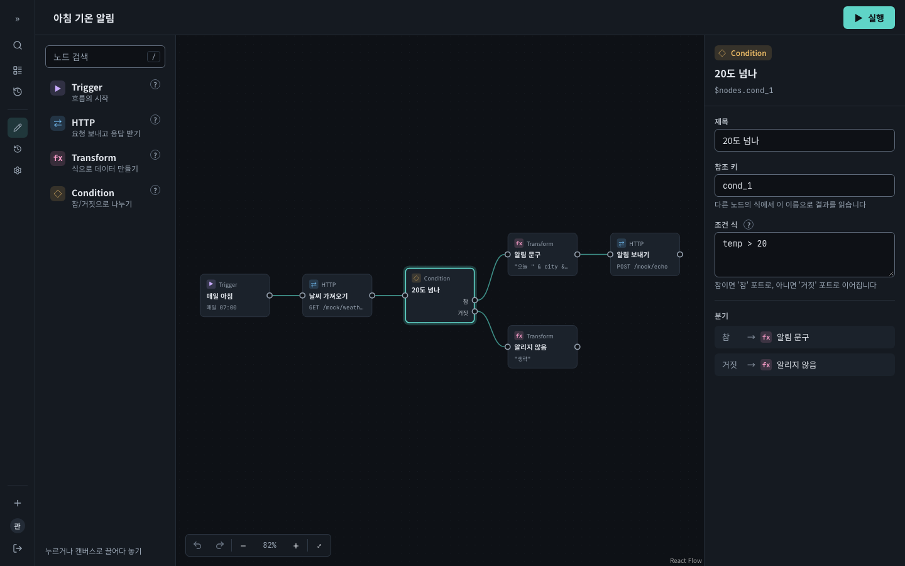
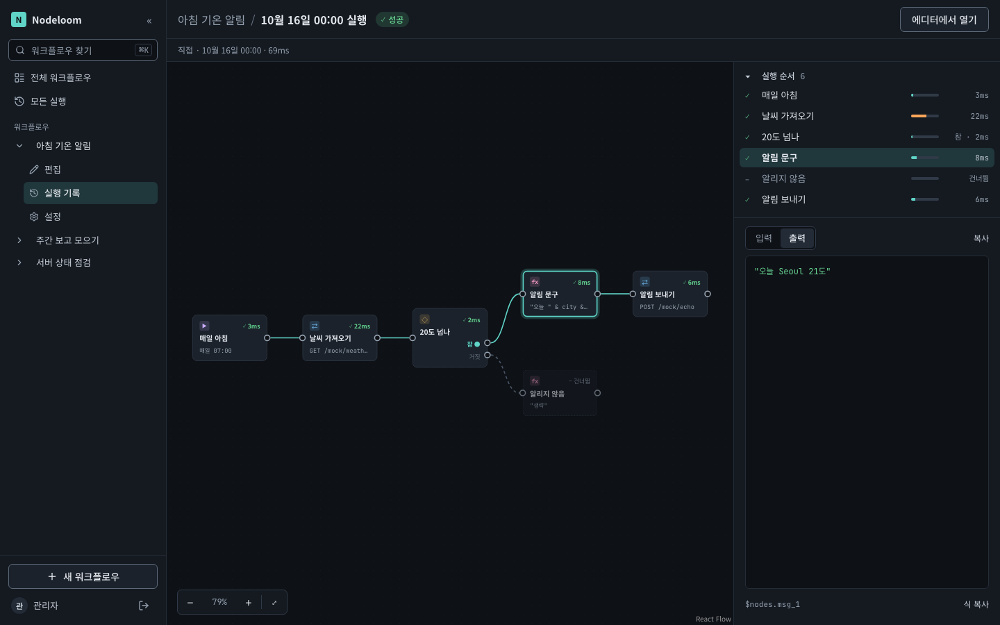
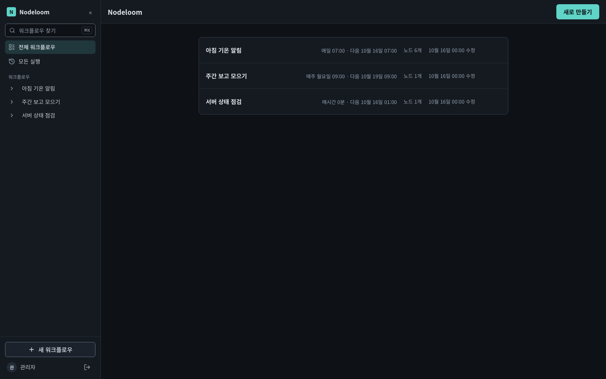
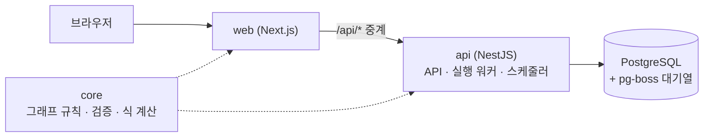
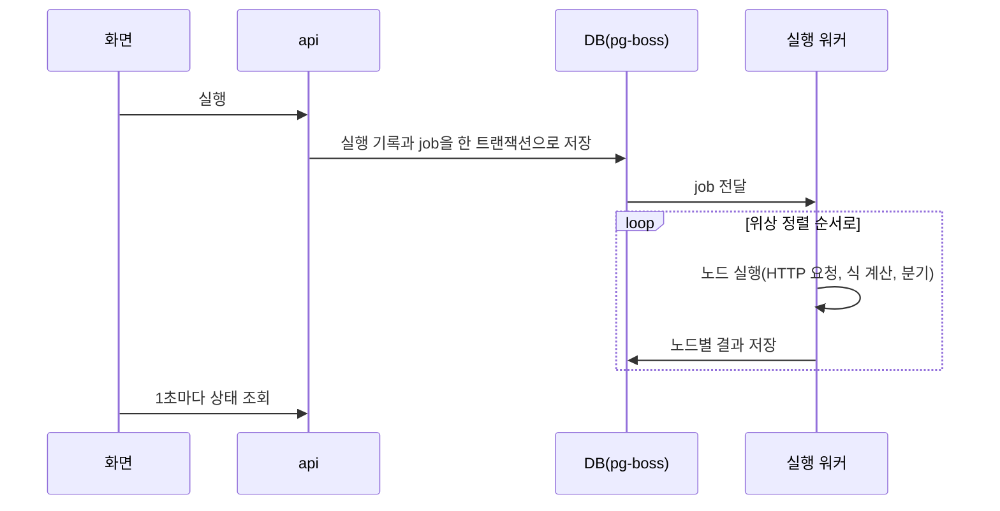

# Nodeloom

노드를 이어 반복 작업을 자동화하는 워크플로우 도구 (Node-based workflow automation)

노드를 이어 흐름을 만들면 서버가 대신 실행해 준다. 1인용이다.

- **에디터:** 노드 4종(Trigger, HTTP, Transform, Condition)을 놓고 이어 흐름을 만든다. 연결할 수 없는 선은 이유와 함께 거부하고, Undo/Redo와 설정 칸의 식 문법 검사가 있다
- **실행:** 서버가 흐름을 끝까지 실행한다. 분기·합류, HTTP 재시도와 시간 제한이 있고, 실패하면 지정한 다른 흐름으로 알린다
- **스케줄과 기록:** 정해진 시각에 실행하고(매일, 평일, 매주, 매시간, cron), 실행마다 노드별 입력과 출력을 남긴다
- **안전장치:** 실행 기록과 로그에서 비밀값을 가리고, 내부망 주소로 가는 요청을 막는다. 로그인 없이 써 보는 데모 모드가 있다

자세한 동작 규칙은 [프로젝트 계획](docs/PROJECT_PLAN.md) 3절에 있다.

## 화면

**에디터:** 노드를 이어 흐름을 만들고, 고른 노드를 오른쪽에서 설정한다.



**실행 상세:** 노드마다 걸린 시간과 상태(✓ 성공, – 건너뜀)를 보고, 노드를 고르면 입력과 출력을 본다.



**워크플로우 목록:** 스케줄과 다음 실행 시각을 함께 보여 준다.



이미지는 `pnpm --filter @nodeloom/browser-tests screenshots`로 다시 찍는다(Docker 필요).

## 구조



- 브라우저는 Next의 `/api/*`만 부르고, Next가 NestJS로 넘긴다. 같은 출처라 CORS가 없고 NestJS는 밖에 열지 않는다.
- web과 api가 core를 함께 쓴다. 에디터의 즉시 검사와 서버의 실행 전 검사가 같은 코드라 결과가 어긋나지 않는다.



- 실행할 때 그래프를 실행 기록에 복사해 두고, 실행과 재개는 그 복사본만 읽는다. 실행 중에 흐름을 고쳐도 영향이 없다.
- 서버가 실행 중에 죽으면 다시 켤 때 이어서 실행하고, 이미 성공한 노드는 건너뛴다.

| 영역     | 선택                                                                                         | 이유                                                       |
| -------- | -------------------------------------------------------------------------------------------- | ---------------------------------------------------------- |
| 모노레포 | pnpm workspace + Turborepo                                                                   | 프론트와 서버가 같은 검증 코드를 쓴다                      |
| 프론트   | Next.js 16 App Router                                                                        | 읽기 화면은 서버 컴포넌트, 에디터는 클라이언트로 나눈다    |
| 캔버스   | React Flow 12(제어 모드)                                                                     | 에디터는 빨리 만들고 렌더링 성능 개선에 집중한다           |
| 상태     | Zustand 5(에디터마다 스토어) + TanStack Query(서버 상태)                                     | 노드 단위로 구독할 수 있다                                 |
| 스타일   | Tailwind 4 + shadcn/ui                                                                       | 서버 컴포넌트와 함께 쓰고, 접근성을 갖춘 부품을 쓴다       |
| 폼·검증  | 폼 라이브러리 없음 + zod 4                                                                   | 설정 값의 원본을 스토어 하나에 두어 Undo가 어긋나지 않는다 |
| 백엔드   | NestJS 12(API, 워커, 스케줄러 한 프로세스)                                                   | 가볍게 두고 실행 엔진은 모듈로 나눈다                      |
| DB·ORM   | PostgreSQL + Prisma 7                                                                        | JSONB, 단순한 마이그레이션                                 |
| 대기열   | pg-boss                                                                                      | Redis 없이 실행 기록과 job 등록을 한 트랜잭션으로 묶는다   |
| 식       | JSONata                                                                                      | 노드 출력에서 값을 꺼내고 바꾸는 식. 시간·깊이 제한을 건다 |
| 인증     | 관리자 1명, bcrypt 해시(환경 변수), JWT 쿠키 7일                                             | 1인 도구에 맞춘 최소 구성                                  |
| 테스트   | Vitest + Testcontainers(실제 Postgres) + Playwright(e2e, 성능 벤치) + Stryker(core 뮤테이션) | 실행 엔진 규칙을 실제 DB로 확인한다                        |

```
apps/
  web/            Next.js: 목록·실행 기록(서버 컴포넌트), 에디터(클라이언트)
  api/            NestJS: 인증, 워크플로우, 실행 기록, 실행 엔진(pg-boss), 연습용 응답(/mock)
  browser-tests/  Playwright: e2e, 성능 벤치, README 화면 이미지
packages/
  core/           그래프 타입, 노드 스키마, 검증, 위상 정렬, 식 계산(순수 TypeScript)
docs/             계획, 컨벤션, 디자인, 성능 기록, 마일스톤별 기록
```

## 실행

필요한 것: Node 24.15 이상(`.nvmrc`), Corepack(pnpm 12), Docker

```bash
corepack enable
pnpm install
cp .env.example .env
pnpm admin:hash        # 터미널 앱에서 실행. 비밀번호를 두 번 입력하고, 출력된 한 줄을 .env의 ADMIN_PASSWORD_HASH 자리에 붙여 넣기
openssl rand -hex 32   # 출력값을 .env의 JWT_SECRET에 넣기
docker compose up -d
pnpm db:migrate        # DB 테이블 만들기(마이그레이션 적용)
pnpm dev
```

- 공개 데모처럼 로그인 없이 쓰려면 `.env`에 `DEMO_MODE=true`를 넣는다. 이때는 해시와 `JWT_SECRET`이 없어도 된다.

- 웹: http://localhost:3000
- 서버 상태: http://localhost:3000/api/health (Next가 NestJS로 중계)

## 명령

| 명령                                          | 내용                                                                                                                        |
| --------------------------------------------- | --------------------------------------------------------------------------------------------------------------------------- |
| `pnpm dev`                                    | web, api, core를 함께 실행                                                                                                  |
| `pnpm db:migrate`                             | DB 마이그레이션 적용                                                                                                        |
| `pnpm admin:hash`                             | 관리자 비밀번호 해시 만들기                                                                                                 |
| `pnpm e2e`                                    | 브라우저로 핵심 흐름 확인(Docker 필요, 처음 한 번 `pnpm --filter @nodeloom/browser-tests exec playwright install chromium`) |
| `pnpm test`                                   | 전체 테스트(api 통합 테스트는 Docker 필요)                                                                                  |
| `pnpm lint` / `pnpm typecheck` / `pnpm build` | 검사와 빌드                                                                                                                 |

Colima를 쓴다면 테스트 전에 다음 환경 변수가 필요합니다.

```bash
export DOCKER_HOST="unix://$HOME/.colima/default/docker.sock"
export TESTCONTAINERS_DOCKER_SOCKET_OVERRIDE=/var/run/docker.sock
```

## 한계

- **최소 한 번 실행:** 요청을 보낸 직후 결과를 저장하기 전에 서버가 죽으면, 이어서 실행할 때 같은 요청을 다시 보낼 수 있다.
- **비밀값 가리기:** 원래 값, URL 인코딩, JSON 문자열 형태만 찾아 가린다. Base64 등 다른 형태로 바꾼 값은 기록에 남을 수 있다.
- **스케줄:** 서버가 꺼져 있던 동안의 회차는 실행하지 않는다.
- **시간대:** `APP_TIMEZONE` 하나만 쓴다. 웹은 빌드할 때 값이 정해지고, 값을 바꾸면 이미 저장한 스케줄은 다시 저장해야 새 시간대로 돈다.
- **사용자:** 관리자 1명이다. 같은 워크플로우는 한 번에 하나만 실행한다.
- **데모 모드:** 연습용 응답(`/mock`)으로만 요청할 수 있고, 자동 초기화가 없다.

## 문서

- [프로젝트 계획](docs/PROJECT_PLAN.md): 목표, 동작 규칙, 마일스톤
- [마일스톤별 기록](docs/milestones)
- [코드 컨벤션](docs/CONVENTIONS.md)
- [디자인 토큰](docs/DESIGN.md)
- [성능 기록](docs/PERFORMANCE.md)
- [백로그](docs/BACKLOG.md)
